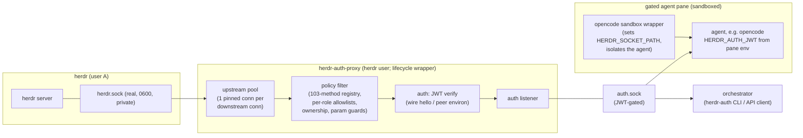
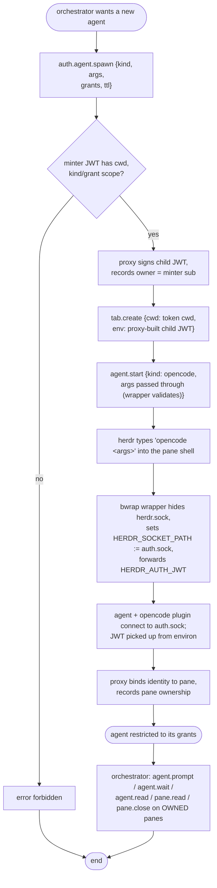

# Architecture

> Status: **design draft**. Written after investigating herdr 0.9.5
> (`github.com/herdrdev/herdr`, API protocol 22, cloned to `/tmp/opencode/herdr`).
> All herdr claims below were verified against that source unless marked otherwise.

## 1. Purpose & scope

`herdr-auth-proxy` sits between herdr clients and the herdr server. It is not a
service: a small **wrapper around the `herdr` command** starts it detached, and
it exits by itself when the herdr server goes away (§10).

- It **connects to herdr's real unix socket** (upstream) and **exposes its own
  socket** (downstream) that speaks herdr's JSON API protocol.
- Each downstream connection is **authenticated with a JWT**; each request is
  **filtered** against the permissions in that JWT.
- A fresh **HMAC-SHA256 signing key is generated in memory on every proxy start**.
  It is never written to disk, so the config dir contains no signing secret and
  all outstanding tokens become invalid when the proxy restarts.

In scope (v1): the **JSON API socket** (`herdr.sock`, NDJSON). This is what agents,
CLIs and integrations use — including the herdr opencode integration plugin.

Out of scope (v1): the binary **client socket** (`herdr-client.sock`, length-prefixed
bincode render/input protocol used by the interactive TUI). Humans keep attaching
directly. See §11.

## 2. Investigated herdr facts (as of 0.9.5)

### 2.1 The protocol

- **JSON API socket** (`~/.config/herdr/herdr.sock`, or `sessions/<name>/herdr.sock`):
  newline-delimited JSON. Request `{"id","method","params"}` → response
  `{"id","result":{...}}` or `{"id","error":{"code","message"}}`.
  **One request per connection**, except *streaming* methods that hold the socket
  open: `events.subscribe`, `events.wait`, `agent.wait`, `agent.prompt` (with wait),
  `pane.wait_for_output`, `server.ssh_agent.register`.
  Limits: 1 MiB line cap, 5 s initial-request timeout. Socket is `chmod 0600`.
- **No authentication whatsoever** on either socket — no handshake, no token, no
  peer-credential check. Filesystem permissions are the entire access control.
- **103 API methods**, registry in `src/api/schema.rs` (`define_operations!`),
  each flagged `changes_ui` / `client_shell`. Full JSON schema:
  `docs/next/api/herdr-api.schema.json`, also `herdr api schema --json`.
  ⚠️ `changes_ui` is **not** a safety taxonomy: `pane.send_text` / `pane.send_keys` /
  `pane.send_input` (raw pty input!) are flagged `changes_ui=false`. The proxy needs
  its own danger classification (§7).
- `ping` returns `version`, `protocol` (22), `capabilities` → the proxy can detect
  upstream version drift at runtime (§8).
- **Socket discovery** (client side): `HERDR_SOCKET_PATH` env → exact path;
  `HERDR_SESSION` → session dir; default config dir. The client socket is derived
  by inserting `-client` before `.sock`.
- **Live handoff**: `server.live_handoff` makes herdr spawn a new server process and
  **rebind the same socket paths**. The proxy must reconnect to upstream, never
  cache the upstream fd.
- Events (`events.subscribe`) are broadcast via an in-memory hub; `pane.focused`
  events do **not** identify which client acted — per-connection attribution from
  events alone is impossible.

### 2.2 Reusable client/server implementation? **No.**

- herdr is a **single binary crate** — no `[lib]` target, not published on crates.io
  (the crates.io `herdr` crate is an unrelated project). `src/api/client.rs` /
  `src/protocol/` cannot be depended on; vendoring the whole repo just for the
  client is not worth it.
- The API client is trivial to re-implement (~100 lines: connect, write one NDJSON
  line, read one NDJSON line). The **method registry / JSON schema is reusable as
  data** and is the authoritative filter input.
- Precedent inside herdr: `herdr remote-api-bridge` (stdio↔socket bridge used by
  `--machine` SSH forwarding) proves transparent API-socket proxying works.

### 2.3 Env vars & pane spawning (critical for the auth design)

- Process-launching methods accept an `env` map: `pane.split`, `workspace.create`,
  `tab.create`, `layout.apply` (per-pane `command: Option<Vec<String>>` + `env`),
  `plugin.pane.open`.
- herdr injects into every managed pane process: `HERDR_ENV=1`, `HERDR_SOCKET_PATH`
  (**herdr's own real socket path**), `HERDR_BIN_PATH`, `HERDR_WORKSPACE_ID`,
  `HERDR_TAB_ID`, `HERDR_PANE_ID`.
- **Verified in code + docs** (`src/pane.rs::apply_pane_launch_env`,
  `src/integration/env.rs::apply_pane_base_env`, socket-api.mdx): *"Herdr-managed
  variables are authoritative when they conflict with caller-provided env."*
  → pane env **cannot** redirect `HERDR_SOCKET_PATH` to the proxy. Consequence:
  a client-side wrapper is unavoidable; v1 uses the deployment's sandbox
  wrapper, which also does the re-pointing (§4.3).
- Non-herdr-managed keys (e.g. `HERDR_AUTH_JWT`) **pass through unchanged** into
  the pane process and all its children. → the JWT can ride in the pane env, no
  protocol changes needed. If the agent executable is itself a sandbox wrapper
  (e.g. this deployment's `opencode`), that wrapper can also do the
  `HERDR_SOCKET_PATH` re-pointing for its child (§4.3), so no helper from this
  project is needed for this path (the bundled helper is deferred — §11).
- `pane.split` / `tab.create` / `workspace.create` have **no `command` param** —
  they always spawn a plain shell with herdr's real socket path in the env.
  Anything later typed/run in such a pane (including `agent.start`) inherits the
  **real** socket path and would **bypass the proxy**. Only `layout.apply` can
  spawn a pane with a wrapped command. This drives the deny-list in §7.
- `agent.start` does **not** exec: it types `<kind-executable> <args>` + Enter into
  an existing shell pane. `kind` is whitelisted by herdr (24 labels), the first
  argv element is fixed per kind, args must be control-char-free. The proxy
  whitelists the **kind** (only the sandbox wrapper); **arguments are passed
  through and validated by the wrapper itself** (decision: arbitrary args).

### 2.4 The opencode integration plugin (persona-1 reference)

`herdr integration install opencode` installs `herdr-agent-state.js` (source:
`src/integration/assets/opencode/`). Verified behavior: it is gated on
`HERDR_ENV=1` + `HERDR_PANE_ID` + `HERDR_SOCKET_PATH`, opens a **fresh connection
per request**, and calls **only** `pane.report_agent` / `pane.report_agent_session`
(params: `pane_id`, `source:"herdr:opencode"`, `agent:"opencode"`, `state`, `seq`,
session ids). → persona "agent" is exactly these two methods (+ `ping`), and the
plugin needs **zero changes** if the pane env carries `HERDR_AUTH_JWT` and
`HERDR_SOCKET_PATH` points at the proxy.

### 2.5 Pane metadata tokens (investigated: can they carry the JWT? No)

`pane.report_metadata` supports arbitrary `tokens` (key ≤32 chars, **value ≤80
chars**, ≤32 keys/pane, TTL, per-source monotonic `seq`). A JWT is 300–800+ bytes →
**metadata tokens cannot carry a JWT**. They remain useful to *display* ownership
(e.g. token `auth_owner=<sub>`, `auth_jti=<jti>` as a reference), but the
authoritative ownership record lives in the proxy (§9). Metadata is display-only
in herdr.

### 2.6 Can the JWT be picked up automatically? **Yes — via the peer's environment.**

On Linux the proxy can, per accepted connection: `SO_PEERCRED` → peer PID →
read `/proc/<PID>/environ` → find `HERDR_AUTH_JWT` (and cross-check
`HERDR_PANE_ID` against the JWT's `pane_id` claim). This works when the proxy runs
as the same uid as the peer (bwrap does **not** change the uid — §6.2) or as root.
It eliminates per-client sockets and relays entirely for pane-spawned clients;
unmodified herdr CLIs and the opencode plugin authenticate implicitly.

## 3. Components & topology



Binaries:

| Binary | Role |
|---|---|
| `herdr-auth-proxy` | session management only: `serve` (default), `wrap`, `stop`, `status`. |
| `herdr-auth` | generic client: `call`, `whoami`, `methods`, `token mint`, `agent spawn`. |
| `herdr-agent` | focused orchestrator client: `spawn` (same atomic extension as `herdr-auth agent spawn`) and `prompt` (plain text from `--text`, `--text-file`, or stdin; no JSON escaping). |
| `herdr-auth-launch` | *deferred / optional later feature*: client helper (exec + relay modes) for deployments without a sandbox wrapper (§11). |

## 4. Authentication design

### 4.1 Keys & JWTs

- **Signing key:** 32 random bytes generated at startup and kept only in the
  proxy's memory. Tokens are HS256 JWTs; there is no private key file, and a
  proxy restart invalidates every token (re-mint after restart).
- **Bootstrap:** at startup the proxy mints a process-scoped
  **orchestrator-scoped** JWT (`sub="bootstrap"`). When started by
  `herdr-auth-proxy wrap`, the token is sent to `wrap` over a pipe (never
  written to disk), and `wrap` sets it as `HERDR_AUTH_JWT` in the herdr process
  environment. If the proxy is already running, `wrap` re-adopts the token from
  the running herdr server's environment and verifies it with the live proxy
  (`auth.hello`); when no server is running it replaces the proxy (safe — no
  token depends on the old key) to get a fresh bootstrap token. A running
  server without a usable token cannot be repaired from outside, so `wrap`
  fails closed and asks for a server restart. Herdr passes that environment to
  every shell it spawns, so `herdr-auth token mint` works from any shell. The
  bootstrap token may mint
  **agent or orchestrator** tokens but never admin; an orchestrator token
  requires `cwd` and `workspace_id`. The bootstrap token is a bearer token, not
  the signing key: it cannot forge tokens and dies with the proxy. Bootstrap is
  **capability-based, not user-identity-based** — the proxy cannot distinguish
  the operator from an agent by uid (bwrap keeps the herdr uid). Because the
  token is inherited by all shells and visible via `/proc/<pid>/environ`, a
  sandbox must use a private PID/`/proc`, and the wrapper must reject non-agent
  tokens. Panes created by `auth.agent.spawn` get a freshly minted agent token
  overriding the inherited bootstrap token; panes created directly in the TUI
  keep the bootstrap token (do not run the agent wrapper there with it).
- JWT (HS256/JWS): claims `iss="herdr-auth-proxy"`, `sub`, `jti`, `iat`, `nbf`,
  `exp`, `role` (`agent`|`orchestrator`|`admin`), `cwd` (canonical working
  directory for panes/agents), `workspace_id` (the only workspace the token may
  create tabs/panes in), and:
  - agent role: `pane_id` (bound to one pane), `grants` (subset of the
    grantable capabilities below).
  - orchestrator role: `perm` object — `agent_kinds` (can only narrow the
    global `["opencode"]` wrapper list), `agent_grants` (which capabilities it
    may hand to spawned agents), `mint_max_ttl_s` (TTL cap). Method allow/deny
    is fixed by role, not token-controlled. Its `cwd` and `workspace_id` are the
    only directory/workspace it may create panes in; child agent tokens inherit
    them and cannot widen them.
- Role minting is fixed: agent → none; orchestrator → agent only; bootstrap →
  agent or orchestrator (never admin); admin → any (reserved, not bootstrapped).
- Minting rules:
  - `cwd` and `workspace_id` are required for bootstrap-minted orchestrator
    tokens; orchestrators inherit both and cannot change them.
  - `pane_id` is valid only for agent tokens. A non-bootstrap minter must own
    the pane. The bootstrap token is the operator and may bind an agent token
    to any existing pane (it owns no TUI-created panes itself), without
    transferring ownership; the agent reaches the pane only through its
    `pane_id` claim and declared grants. `auth.agent.spawn` remains the path
    that creates and owns a new pane.
  - child `sub` is always `minter:jti[:label]`; a caller cannot choose a bare
    `sub` or impersonate another owner.
  - `perm.agent_kinds` may only narrow the global sandboxed list (`opencode`);
    `perm.mint_max_ttl_s` caps the child TTL. `mint_roles` was removed.
  - child `exp` is clamped to the minter's `exp` and TTL cap; agent tokens
    default to 24 h.
- TTL: a child token's `exp` is always **clamped to the parent's `exp`** (a child
  never outlives its minter). When the minter is an infinite orchestrator token,
  the requested/default agent TTL applies (default 24 h, configurable), and the
  token is re-minted if a pane is restored after a herdr restart. Every
  requested TTL is also capped by the proxy-wide `max_token_ttl_s` (default
  24 h), so `--ttl-s` can never request an arbitrarily long-lived token. Child
  tokens are always a **subset** of the minter's permissions (enforced by
  intersecting `perm`/`grants` before signing).

### 4.2 Connection association (two modes, both fail-closed)

There is **no uid-based trust**: the sandbox is bwrap, which keeps the herdr uid
(§6.2), so a peer uid proves nothing. Identity is always a JWT.

1. **Wire hello** (explicit): first line on the connection must be
   `{"id":...,"method":"auth.hello","params":{"jwt":"..."}}`. On success the
   connection is associated with the token's identity; subsequent lines are pure
   herdr NDJSON forwarded upstream. Used by `herdr-auth` CLI clients and
   (later) the deferred relay mode.
2. **Peer-environ extraction** (implicit, recommended for pane children): if the
   first line is *not* `auth.hello`, the proxy reads the JWT from the connecting
   process's environment via `SO_PEERCRED` + `/proc/<PID>/environ` (§2.6), then
   proceeds as above.

Proxy-namespace methods (`auth.hello`, `auth.whoami`, `auth.token.mint`,
`auth.methods`) are answered by the proxy itself and never forwarded.
Anything else with no valid token → herdr-style error line
`{"id":...,"error":{"code":"unauthorized",...}}` and close.

### 4.3 The sandbox wrapper (bring-your-own; no shell changes)

Because pane env cannot override `HERDR_SOCKET_PATH` (§2.3), the deployment uses
its own **bwrap-based wrapper** for the `opencode` executable. No shell changes
(no `default_shell`), no helper from this project (v1).

**Wrapper contract** (what the deployment provides):

1. start the agent in a bwrap sandbox whose mount namespace **hides herdr's real
   socket** (no `~/.config/herdr` bind) **and always bind `/dev/null` over every
   real herdr socket** inside the namespace (`herdr.sock`,
   `herdr-client.sock`, the active session equivalents, and any inherited
   custom `HERDR_SOCKET_PATH` plus its `-client` sibling) — this is the security
   boundary; the uid is unchanged (§6.2);
2. use a **private PID namespace and `/proc`** (`--unshare-pid --proc /proc`) so
   the agent cannot read the inherited bootstrap token or other peer tokens via
   `/proc/<pid>/environ`;
3. bind **only the proxy's `auth.sock`** (not the whole runtime dir, which also
   contains the pid file) and export `HERDR_SOCKET_PATH=<auth.sock>` for the
   agent;
4. forward `HERDR_AUTH_JWT` from the pane env into the sandbox (strip any
   inherited/foreign token first);
5. validate agent arguments itself — the proxy passes `args` through unchanged
   and whitelists only the `kind`;
6. set the agent cwd from the token's `cwd` claim and never fall back to herdr's
   original `HERDR_SOCKET_PATH`.

Panes created by `auth.agent.spawn` are still plain shells internally (herdr's
real socket path in their env), but raw input is denied and the only command
ever typed into them is the whitelisted `opencode` wrapper, which sandboxes and
re-points the agent. Orchestrators cannot create a plain pane directly:
`pane.split`, `tab.create` and `agent.start` are denied. `layout.apply` is
denied because it would let a caller specify arbitrary argv that herdr executes
directly (as the herdr user, with the real socket path), i.e. a full bypass.

`herdr-auth-launch` (exec mode: re-point + optional uid drop; relay mode:
per-client socket + `auth.hello` stamping) is **deferred** (§11) for deployments
without a sandbox wrapper.

### 4.4 Activity diagram — connection & request flow

```mermaid
flowchart TD
    S([agent starts in sandbox wrapper]) --> W["wrapper sets HERDR_SOCKET_PATH := auth.sock<br/>keeps HERDR_AUTH_JWT<br/>agent has no access to herdr.sock"]
    W --> C1[client connects to auth.sock]
    C1 --> A0[proxy accepts<br/>SO_PEERCRED pid]
    A0 --> A1{first line is auth.hello?}
    A1 -- yes --> A2[verify JWT signature, exp, nbf<br/>load identity + perm]
    A1 -- no --> A3[read /proc/&lt;pid&gt;/environ<br/>extract HERDR_AUTH_JWT]
    A3 --> A4{JWT found + valid?<br/>HERDR_PANE_ID == claim.pane_id?}
    A4 -- no --> DENY0[error unauthorized, close] --> X0([end])
    A4 -- yes --> A2
    A2 --> PIN[open pinned upstream conn to herdr.sock]
    PIN --> LOOP[[per request line on connection]]
    LOOP --> P1{method known to proxy registry?}
    P1 -- no --> LOG[WARN log 'new-command' tag] --> DENY1[error unknown_method] --> LOOP
    P1 -- yes --> P2{allowed by role allowlist?}
    P2 -- no --> AUD[audit-log deny] --> DENY2[error forbidden] --> LOOP
    P2 -- yes --> P3{param guards pass?<br/>pane ownership / binding,<br/>kind whitelist,<br/>env authority}
    P3 -- no --> DENY2
    P3 -- yes --> P4{streaming method?}
    P4 -- no --> F1[forward line upstream,<br/>relay one response line,<br/>record created ids / filter lists] --> LOOP
    P4 -- yes --> F2[forward + relay pushed lines<br/>until close (pinned upstream)] --> LOOP
    LOOP --> CLOSE([connection closed])
```

### 4.5 Activity diagram — orchestrator spawns a gated agent



The atomic `auth.agent.spawn` does mint + `tab.create` + `agent.start` in one
call, with token binding and failure cleanup (§7.1). Direct `pane.split`,
`tab.create` and `agent.start` are denied for orchestrators.

## 5. Personas

| Persona | Token | Allowed herdr methods (default) |
|---|---|---|
| **agent** (use case 1) | role=agent, `pane_id`-bound, `grants[]` | `ping` always; `report_status` → `pane.report_agent`, `pane.report_agent_session` (`pane_id` must equal the claim; `agent`/`source` pinned to `opencode`); `report_metadata` → `pane.report_metadata` (own pane); `read_own_pane` → `pane.get`, `pane.read`, `agent.get` (own pane); `wait_own_output` → `pane.wait_for_output`, `agent.wait` (own pane; `target` forced to the claim). Default: `["report_status"]`. Exactly covers the opencode plugin. |
| **orchestrator** (use case 2) | role=orchestrator, perm object | **Minimal workflow allowlist (default-deny)**: `ping`; create: **only** `auth.agent.spawn` (atomic, proxy env/cwd/token authority); read (owned only, list responses filtered): `pane.list`, `pane.get`, `pane.read`, `pane.wait_for_output`, `tab.list`, `tab.get`, `agent.list`, `agent.get`, `agent.read`, `agent.wait`; control (owned): `tab.close`, `pane.close`, `agent.prompt`; extensions: `auth.whoami`, `auth.methods`, `auth.token.mint`, `auth.agent.spawn`. **Everything else is denied** — including direct `pane.split`, `tab.create` and `agent.start` (they create/use plain shells), `layout.apply`, `events.*`, `workspace.*`, `worktree.*`, `plugin.*`, `integration.*`, `pane.send_*`, `agent.send_keys`, `command.invoke`, and all UI/focus/zoom/scroll methods. |
| **admin** (reserved) | role=admin | All methods + `auth.*`; not issued by the default bootstrap (the bootstrap token is orchestrator-scoped and cannot mint admin). |

**Grantable agent capabilities.** An orchestrator may grant only a subset of
this list *and* of its own `agent_grants` (a child never exceeds its parent).
An orchestrator's ceiling defaults to the **full list** when its token has no
`perm.agent_grants`, so every advertised capability is actually grantable; an
explicit `perm.agent_grants` narrows it. Agent tokens default to
`["report_status"]` when no `grants` are requested. `ping` is always allowed.

| Grant | Unlocks (own pane only) |
|---|---|
| `report_status` | `pane.report_agent`, `pane.report_agent_session` (pane forced to the claim) |
| `report_metadata` | `pane.report_metadata` |
| `read_own_pane` | `pane.get`, `pane.read`, `agent.get` |
| `wait_own_output` | `pane.wait_for_output`, `agent.wait` (target forced to the claim) |

**Default-deny.** The orchestrator allowlist is exhaustive for the current
orchestrator/developer/reviewer workflow; everything else is denied until
deliberately added. That includes all raw input (`pane.send_text`,
`pane.send_keys`, `pane.send_input`, `pane.input.set`, `agent.send_keys`,
`command.invoke`), `layout.apply` (explicit argv = unsandboxed code as the herdr
user), `events.*` (unfiltered events would leak non-owned panes — use
`agent.wait`/`agent.read`), `workspace.*`, `worktree.*`, `plugin.*`,
`integration.*`, `server.*`, `notification.show`, and all UI methods.
The orchestrator cannot create a plain pane: `pane.split`, `tab.create` and
`agent.start` are denied. The only creation path is `auth.agent.spawn`, which
mints the child token, creates the root pane with the proxy-built env and token
`cwd`, starts the whitelisted wrapper, and records ownership (§7.1). The
resulting shell is a plain shell, but the only command ever typed into it is the
sandbox wrapper (raw input is denied), so the agent runs under bwrap and never
with herdr's real socket. `layout.apply` is denied: it takes explicit argv
(bypassing the wrapper) and herdr executes it as the herdr user with the real
socket path — a full bypass.

## 6. Security boundary & bypass prevention

1. **The proxy is the only auth boundary** — herdr contributes none (§2.1).
2. **Sandboxed agents must not be able to open herdr's real socket.** The
   deployment's **bwrap** wrapper hides `~/.config/herdr` (the socket) in the
   mount namespace **and binds `/dev/null` over every real herdr socket path**
   (`herdr.sock`, `herdr-client.sock`, session equivalents) so a stray bind or
   forgotten hide still cannot expose a connectable socket. The uid stays the
   herdr uid, so **uid is not a trust signal** and the proxy never authorizes by
   uid (§4.2). If the sandbox leaks the real socket path, the agent can bypass
   the proxy entirely — the wrapper's mount configuration is the boundary.
   Because uid is shared, the proxy must be able to read the peer's environ
   (same uid, or run as root). The sandbox must also use a private PID
   namespace / `/proc`, otherwise `/proc/<pid>/environ` exposes the inherited
   bootstrap token (and other peer tokens).
3. **auth.sock is world-connectable by design** (`0666` or group ACL) — connecting
   is free, *authorizing* is the JWT. Unauthenticated connections are rejected
   at the first line; local DoS surface is accepted.
4. **Fail closed**: unknown methods, malformed JSON, missing/expired token,
  environ unreadable → deny + close. `forward_unknown` config flag exists but
   defaults to `false`.
5. Environ extraction caveats (accepted): the token is visible to same-uid
   processes via `/proc` (same exposure as any env credential); a token holder
   can always present its own token (theft = full grant of *that* token's scope
   only — TTL limits + pane binding limit blast radius). Root is only needed if
   the proxy runs as a different uid than the agents.
6. One pinned upstream connection per downstream connection (streaming methods,
   live-handoff reconnect, no pooling — §2.1).

## 7. Filtering engine

- **Explicit allowlists, default-deny.** Role presets enumerate every allowed
  method; no wildcards. Methods outside the current orchestrator / developer /
  reviewer workflow (`events.*`, `workspace.*`, `worktree.*`, `plugin.*`,
  `integration.*`, layout, UI/input) stay denied until deliberately added.
- Embedded **method registry** generated from herdr's schema
  (`docs/next/api/herdr-api.schema.json` / `herdr api schema --json`), pinned to
  protocol 22 (0.9.5). Regeneration script in-repo; bump = regenerate + review.
- Per-method **danger classes** (our own, not herdr's `changes_ui`):
  `readonly`, `ui`, `raw_input`, `spawn`, `lifecycle`, `admin`.
- **Param guards**: pane-targeting methods check ownership (§9); agent-role
  `pane_id`/`target` params must equal the claim (a foreign or nonexistent pane
  is `forbidden`, never silently rewritten). Agent reporting is pinned to the
  only sandboxed kind (`agent="opencode"`, `source="herdr:opencode"`) so an
  agent cannot relabel its own pane; `resume_argv` is rejected because herdr
  later executes it as the herdr user. `auth.agent.spawn` whitelists the `kind`
  only (`["opencode"]`, the sandbox wrapper) and passes `args` through — the
  wrapper validates them; direct `agent.start` is denied to orchestrators;
  `layout.apply` is denied (explicit argv = bypass).
  **Env authority**: for every process-launching method the proxy builds the env
  — caller env is validated, not trusted: only `HERDR_AUTH_JWT` (proxy-injected)
  and caller-approved keys survive; `PATH`, `SHELL`, `ENV`, `BASH_ENV`,
  `LD_PRELOAD`, `LD_LIBRARY_PATH`, `NODE_OPTIONS`, `PYTHON*` and all `HERDR_*`
  are stripped (herdr overrides its own anyway). The proxy injects the child
  token and never lets the caller choose a gating mode.
  **Cwd/workspace authority**: `auth.agent.spawn` always uses the caller
  token's canonical `cwd` and `workspace_id`; a caller-supplied value must equal
  the claim or the request is `forbidden` (`missing_cwd` / `missing_workspace`
  if the token has none). The resolved pane cwd is recorded in proxy state.
  Direct `pane.split` / `tab.create` are admin-only and use the same rule when
  the admin token carries those claims. herdr 0.9.5's `agent.start` has no cwd
  parameter — the agent inherits the pane shell's cwd.
- **Owned-only visibility**: `pane.list`, `agent.list`, `workspace.list`,
  `tab.list` and `session.snapshot` responses are filtered to the caller's owned
  ids; detail methods on non-owned ids return `forbidden`.
- Response lines for allowed calls pass through **unmodified** (no id rewriting
  needed — herdr targets stable string ids like `w1:p1`, never per-connection
  client ids on this socket), except the list/snapshot filtering above.

### 7.1 Proxy extension methods (`auth.*`)

The proxy reserves the `auth.*` namespace and answers it locally (herdr answers
`unknown_method` for it today). Same envelope as herdr, so clients reuse the
NDJSON codec:

```
→ {"id":"r1","method":"auth.agent.spawn","params":{"kind":"opencode"}}
← {"id":"r1","result":{"tab_id":"w1:t3","pane_id":"w1:p7","agent":"opencode"}}
```

| Method | Purpose |
|---|---|
| `auth.hello` | first-line wire auth (§4.2) |
| `auth.whoami` | identity/claims/permissions (debugging) |
| `auth.token.mint` | mint a scoped child token (subset + `exp` clamped to minter) |
| `auth.methods` | proxy-known herdr methods + policy (introspection) |
| `auth.agent.spawn` | **atomic**: `tab.create` + mint/bind child token + `agent.start` (kind whitelist; args passed to the wrapper); closes the tab and revokes the token if any step fails |

`auth.agent.spawn` params: `kind`, `args`, optional `name`, `label`, `focus`,
`ttl_s`, `grants` (agent tokens never carry `perm`, so it is rejected). The
caller never supplies `env`; the proxy builds it
and injects the child token. The tab/root pane is always created in the caller
token's `cwd` and `workspace_id`; supplied values are only accepted if they
equal the claims. Requested `grants` are intersected with the global grantable
set and the caller's `agent_grants`; an over-request is an error
(`grant_not_allowed`).

**Binding subtlety**: the token must be in the pane env at `tab.create` time, but
the pane id is only known from the response. Mint a `pending` token (`jti` only),
inject it, then bind `jti → root_pane.pane_id` on the response and record
ownership. No agent connects before `agent.start`, so the bind is always in
place; revoke the `jti` on failure. This is the only creation path exposed to
orchestrators; direct `pane.split` / `tab.create` / `agent.start` are denied
(admin-only), so every orchestrator-created pane goes through this binding and
cleanup path.

**How clients call extensions** (they are not in the herdr CLI):

1. **`herdr-auth` CLI** (shipped with the proxy): `herdr-auth agent spawn --kind
   opencode --cwd … -- <args>`; generic `herdr-auth call auth.agent.spawn --json
   '{…}'`; `herdr-auth token mint …`. The focused **`herdr-agent`** CLI wraps
   `spawn` and `agent.prompt`; prompt text is read verbatim from `--text`,
   `--text-file`, or stdin instead of being embedded in a JSON params argument.
   Auth via `HERDR_AUTH_JWT` in its env (peer-environ mode) or `--token`.
2. **Raw NDJSON** with any tool, e.g. `printf '%s\n' '{"id":"1","method":
   "auth.agent.spawn","params":{…}}' | socat - UNIX-CONNECT:<auth.sock>` (the
   connecting process must carry `HERDR_AUTH_JWT`, or send `auth.hello` first).
3. **Client library / SDK**: the same one-request-per-connection pattern as
   herdr's API client (§2.2).

## 8. Unknown/new command logging (explicit requirement)

- Any method name not in the registry → **default-deny** + `WARN` log line tagged
  `[new-command]` with method name, role, and sub — so new herdr commands are
  surfaced for policy updates instead of silently forwarded or dropped.
- At startup and periodically: proxy calls upstream `ping`, compares
  `result.protocol` (22) against the embedded registry's protocol; on mismatch,
  `WARN` with instructions to regenerate the registry (and optionally diff
  against a freshly fetched `herdr api schema --json`).
- Deny decisions are audit-logged (method, sub, jti, pane, reason).

## 9. Pane ownership (orchestrator use case)

- The proxy records pane/tab/workspace ids **from creation responses**. For
  orchestrators that is the `tab.create` inside `auth.agent.spawn`; admin-only
  direct `pane.split`/`tab.create` are recorded the same way. `workspace.create`
  is never allowed for orchestrators and `layout.apply` stays denied. Ownership
  is keyed by the authenticated `sub` (+ child token `jti` for agent panes).
- Ownership is **persisted** across restarts (state dir, e.g. SQLite/JSON) — the
  proxy, not herdr, is authoritative.
- Enforcement: every pane-targeting request validates `pane_id` against the
  caller's owned set (orchestrator); agent-role requests are pinned to their own
  `pane_id` claim; list/snapshot responses are filtered to owned ids.
- Bootstrap minting is the one exemption: the operator may bind an agent token
  to an existing pane it does not own, but ownership is **not** transferred.
  Non-bootstrap orchestrators must own the pane. The agent still reaches only
  that pane and only through its declared grants.
- Optional mirror into herdr for visibility: proxy calls `pane.report_metadata`
  (source `auth-proxy`) with `auth_owner=<sub>`, `auth_jti=<jti>` tokens (80-char
  limit is fine for references, not for JWTs — §2.5). Display only.
- Reconciliation: on startup / periodically, `pane.list` + tokens to rebuild
  ownership for panes that survived a proxy restart.

## 10. Lifecycle (no systemd service)

Verified herdr 0.9.5 lifecycle: the `herdr` client auto-spawns `herdr server` as a
**detached daemon** (`Command::new(current_exe).arg("server")`, stdio → `/dev/null`,
`setsid()`), waits ≤15 s for the socket, then exits when the client detaches —
the server keeps running. It stops via `herdr server stop` (API `server.stop`),
a signal (`SIGTERM`/`SIGINT`), or host shutdown; `server.live_handoff` starts a new
process that transfers PTYs and **rebinds the same socket paths**. There is no
"exit when no clients" behaviour.

Consequences: wrapping the client cannot track the daemon's lifetime, and a PATH
wrapper cannot intercept the daemon (the daemon command is built from
`current_exe`, i.e. the real binary). Design:

- `herdr-auth-proxy wrap -- herdr "$@"` (or an equivalent `herdr` wrapper script)
  ensures the proxy is running for the resolved socket, resolves a valid
  bootstrap token for this herdr session (fresh from the proxy, re-adopted from
  the running server, or after replacing a stale proxy), then `exec`s herdr with
  `HERDR_AUTH_JWT` set.
- The proxy **daemonizes** (`setsid`, own log + pidfile/lockfile; idempotent), so
  the wrapper can exit with the client while the proxy keeps serving.
- The proxy waits for `herdr.sock` to appear, serves, and **exits by itself** once
  the real socket has been gone/unreachable for a grace period (default 15 s —
  longer than a live handoff takes). `herdr server stop` → socket removed → the
  proxy exits.
- `herdr-auth-proxy stop` for explicit shutdown; `status` for health.
- Socket path resolution mirrors herdr: `HERDR_SOCKET_PATH` → `HERDR_SESSION` →
  `--session` → `<config>/herdr.sock` (§2.1).

```toml
# config.toml (flat; all optional)
upstream_socket = "auto"       # or an explicit path; "auto" follows herdr
auth_socket = "auto"           # $XDG_RUNTIME_DIR/herdr-auth-proxy/auth.sock
agent_ttl_s = 86400            # default agent lifetime
max_token_ttl_s = 86400        # hard cap for every requested TTL
death_grace_s = 15
```

The signing key is never persisted. State lives in
`$XDG_STATE_HOME/herdr-auth-proxy/`; the auth socket and pid file live in
`$XDG_RUNTIME_DIR/herdr-auth-proxy/`. There is no bootstrap-token file.

Packaging: `packages.default` builds all binaries;
`nixosModules.default` (opt-in `programs.herdr-auth-proxy.enable`) and
`homeManagerModules.default` only add the package — no service, by design.

## 11. Out of scope / future work

- `herdr-auth-launch` client helper (exec mode: re-point `HERDR_SOCKET_PATH`
  + optional uid drop; relay mode: per-client socket + `auth.hello` stamping)
  — **deferred**; v1 relies on the deployment's own sandbox wrapper (§4.3).
- Proxying the binary client socket (`herdr-client.sock`) for gated TUI clients.
- Event-stream filtering by ownership (v1 forwards subscribed events unfiltered;
  events carry no client attribution — §2.1).
- Multi-session / multi-user upstreams (v1: exactly one upstream socket).
- Token revocation list / short-lived minting cache.
- Admin minting via a separate control socket (v1: no admin token is issued by
  the bootstrap — §12).
- Non-Linux support (SO_PEERCRED + /proc environ is Linux-only; the deferred
  relay mode would be the portable fallback).

## 12. Decisions & remaining questions

Decided in review:

- **No systemd service**: a `wrap` helper starts the proxy detached; the proxy
  exits with the herdr server (§10).
- **JWT-only auth**: no uid trust — bwrap keeps the herdr uid (§4.2/§6).
- **Sandbox = the deployment's bwrap wrapper**: hides the real socket, sets
  `HERDR_SOCKET_PATH`, forwards `HERDR_AUTH_JWT`, validates args; the proxy only
  whitelists the kind (§4.3/§7).
- **Owned-only** orchestrator visibility, including filtered list/snapshot
  responses (§5/§9).
- **Default-deny to the current workflow**: everything outside the minimal
  orchestrator/developer/reviewer allowlist is forbidden — including
  `layout.apply`, `events.*`, `workspace.*`, `worktree.*`, `plugin.*`,
  `integration.*`, UI and raw-input methods (§5/§7).
- **`agent.send_keys` denied.**
- **Spawn**: only the atomic `auth.agent.spawn` (proxy env/cwd authority + token
  auto-binding + cleanup); direct `pane.split`, `tab.create` and `agent.start`
  are denied for orchestrators because they create/use plain shells that run
  arbitrary code as the herdr user. **`layout.apply` denied** — it accepts
  explicit argv that herdr executes directly as the herdr user with the real
  socket path (a full bypass). Pane creation and agent start are pinned to the
  token's `cwd` claim; callers cannot choose a different directory.
- **Grants**: defined set; an orchestrator's grant ceiling defaults to the full
  advertised set (narrow with `perm.agent_grants`); agent tokens default to
  `["report_status"]`; `read_own_pane`/`wait_own_output` are explicit grants.
- **Bootstrap**: `herdr-auth-proxy wrap` receives the process-scoped,
  orchestrator-scoped bootstrap token from the proxy over a pipe and sets it as
  `HERDR_AUTH_JWT` on the herdr process; all herdr shells inherit it. If the
  proxy is already running, `wrap` re-adopts the token from the running herdr
  server (verified with `auth.hello`) or replaces the proxy when no server is
  running; a running server without a usable token is an explicit error (its
  environment cannot be changed externally). No file is written. `herdr-auth
  token mint` uses that environment token to mint agent or
  orchestrator tokens (an orchestrator token requires both `cwd` and
  `workspace_id`), but **cannot mint admin**. As the operator token it may also
  bind an agent token to an existing pane it does not own, without transferring
  pane ownership.
  The signing key stays in memory, so a proxy restart invalidates all tokens. The
  proxy **cannot** verify that a client is the operator (uid is shared, bwrap
  keeps the herdr uid); the bootstrap token being confined to herdr's process
  environment and kept out of sandboxes is the check.
- **Child token lifetime**: `exp ≤ minter exp` and `≤ now + max_token_ttl_s`;
  with an infinite orchestrator the default agent TTL applies (24 h), re-mint on
  restore.
- **herdr pinning**: CI regenerates the registry and runs the deny tests.
- **License**: Apache-2.0.

Remaining:

1. **Real-world validation**: integration test against a real herdr + the real
   opencode plugin (current tests use a fake upstream).
2. **Grace period**: default 15 s (`death_grace_s`), confirm against live
   handoff timing.
